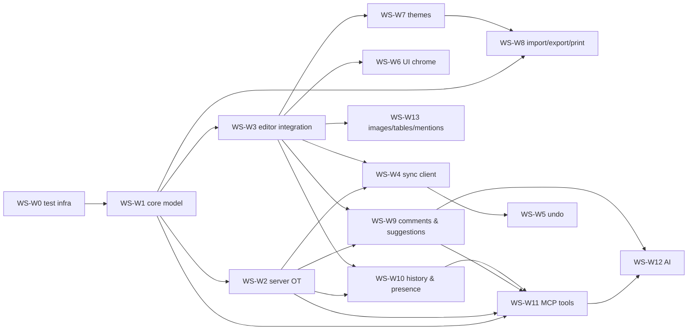

# Write 10 · Implementation Plan, Workstreams and Testing Strategy

This plan breaks Wonky Write into **workstreams (WS-W\*)** that different engineers or coding
agents can build **in parallel** with minimal interference. It aligns with the suite roadmap
[../14-roadmap.md](../14-roadmap.md) (milestones M0–M7, suite workstreams
WS-0…WS-13) and the quality spec
[../11-quality-testing-accessibility.md](../11-quality-testing-accessibility.md).

Specs per workstream: model [02](02-document-model.md), sync [03](03-sync-protocol.md), editor
[04](04-editor.md), screens [05](05-screens-menus-toolbar.md), themes [06](06-themes.md),
import/export/print [07](07-import-export-print.md), collaboration
[08](08-comments-suggestions-history.md), MCP & AI [09](09-mcp-and-ai.md).

---

## 1. Principles

1. **Contract first.** Each workstream starts by committing its public Dart interfaces, Serverpod
   model YAMLs and endpoint signatures with **stub/fake implementations** (§4). Dependents code
   against the interfaces and fakes from day one; real implementations replace stubs without
   API changes.
2. **Ownership by folder.** Each workstream owns specific folders (§3). Edits outside one's
   folders are limited to **additive registrations** (§5).
3. **Pure core first.** Anything that can be pure Dart (`wonky_write_core`) is built and tested
   there before UI work depends on it — it's the cheapest code to test and is shared by client,
   server, MCP and AI.
4. **Vertical slices per milestone.** Every milestone ends with a demo on web and macOS through
   the critical journeys of [11](../11-quality-testing-accessibility.md) §1.1.
5. **Tests are part of the contract.** Interfaces ship with a conformance test suite that every
   implementation (fake and real) must pass.

---

## 2. Milestone mapping (Write)

| Suite milestone | Write scope | Exit criteria (Write) |
|-----------------|-------------|------------------------|
| **M0 · Foundations** | Package scaffolds (`packages/wonky_write_core`; the `wonky_write` app joins the workspace and runs on `wonky_app`, served at `/write/`), contract stubs for W1–W5 (§4), vendored `super_editor` in `third_party/` (suite 01 §2.3), dependency-rule CI, Write test infra skeleton (WS-W0), spikes S1–S3 (§8). | `wonky_write_core` builds on VM + web; editor screen shows a hard-coded Delta via the mapper stub; spikes reported. |
| **M1 · Shell & Drive** | Write app config in the shell (routes `/d/:uuid…`, home filtered to documents), `DriveEndpoint.createDocument` with `Document` row, empty editor route with title field, Write settings page stub. | Create/open/rename/trash documents from the Write home. |
| **M2 · Write MVP** | W1 (schema, validator, normalizer, Markdown codec, IR), W2 (OT server), W3 (mapper, applier, extractor, core editing behaviours of 04), W4 (sync client + offline outbox), W5 (undo), W6 core chrome (menubar, toolbar, status bar, outline, find/replace, word count), W7-lite (Wonky Default theme through `WriteStylesheetBuilder`, fonts pipeline), W8-lite (Markdown/TXT/HTML import, Markdown/TXT export, page setup model + Pages/Pageless rendering), W11-lite (`write.get_document`, `write.insert_markdown` for journey 8 smoke). | Journeys 1–3 (Write parts); OT fuzzer, undo fuzzer, mapper/applier property tests green; keystroke budget met on 100 pages. |
| **M3 · Sheets MVP** | (Write) hardening: perf, IME QA on Windows/Linux, bug fixes; W13 images (upload, offline queue) and mentions. | No P0 Write bugs open; perf budgets green in CI. |
| **M4 · Collaboration** | W9 (comment anchors, margin, suggestions, accept/reject, decisions), W10 (history diff/restore, presence cursors, follow, agent presence). | Journeys 2, 5, 6; OT fuzzer including overlays green. |
| **M5 · Depth** | W7 full (theme model, 8 built-ins, theme editor, contrast checker, all component builders), W8 full (pagination engine, PDF, HTML, DOCX, ODT, RTF, EPUB, DOCX/ODT/RTF import, print preview, export endpoint), W13 tables editor, W6 remaining dialogs (page setup, export, document properties). | Journeys 7, 9; export validator CI green; theme goldens green. |
| **M6 · Agents & Automation** | W11 full (`write.*` tools, `ui.write.*`, resources, prompts), W12 (assistant tool binding, inline rewrite, continue, summarize/outline/proofread, AI undo grouping). | Journeys 8, 10 (Write parts); MCP integration suite green. |
| **M7 · Polish & Scale** | A11y audit (editor semantics, announcements), i18n (pseudo-locales, RTL documents), deferred loading (exporters, theme editor, AI), large-doc perf (2M chars), spellcheck (P1), P1 backlog. | Budgets in 11 §2 met; a11y checklist complete. |

---

## 3. Workstreams

Each entry: **scope · owned folders · provides · depends on · deliverables · acceptance tests ·
milestone**. "Depends on" refers to *interfaces* (available from M0/M2 week 1 as stubs), not to
finished implementations, unless marked **(impl)**.

### WS-W0 · Write test infrastructure and corpora
- **Scope**: random valid Delta generator, random edit generator (text/format/block/embed/
  overlay ops), in-process multi-client OT simulator (`WriteSimulator` with network delay/reorder/
  disconnect), document corpus (`wonky_write/test_corpus/`: Markdown, HTML from Google Docs/Word,
  DOCX/ODT/RTF fixtures, 100-page perf doc, Unicode/RTL/emoji doc), golden helpers (font loading
  for tests, PDF rasterization via `pdftoppm`), CI validator image (LibreOffice, epubcheck, Nu
  checker, ODF validator, poppler).
- **Owns**: `wonky_write_core/test/support/`, `wonky_write/test_corpus/`, `tool/write_ci/`.
- **Provides**: `DeltaGen`, `EditGen`, `WriteSimulator`, `CorpusLoader`, `GoldenPdf`.
- **Depends on**: W1 interfaces. **Milestone**: M0 → ongoing.

### WS-W1 · Core document model (`wonky_write_core`)
- **Scope**: Wonky Delta Schema v1 types, `WonkyDeltaValidator`, `WonkyDeltaNormalizer`,
  canonical JSON + SHA-256 hashing, `MarkdownCodec` (import/export, front matter, escaping),
  `DocTree` IR (`DocTreeBuilder`, `DocTreeToDelta`), derived data (outline, stats, plain text),
  `AddressResolver` (quote/heading/offset) and `DocumentEdits` op builders (insert Markdown,
  replace range with minimal diff, format, block type, tables) shared by commands, MCP and AI.
- **Owns**: `wonky_write_core/lib/{delta,markdown,ir,derived,edit}/`.
- **Provides**: interfaces in §4.1. **Depends on**: `wonky_core` (WS-1).
- **Deliverables**: all of 02 §1–§2, §5; 07 §2.1; 09 §7 `edit/`.
- **Acceptance**: Markdown round-trip property test (10k docs), validator/normalizer idempotence
  (`normalize(normalize(d)) == normalize(d)`), `DocumentEdits` results always validate, address
  resolver Unicode tests. **Milestone**: M0 (contracts) → M2.

### WS-W2 · Server OT and persistence
- **Scope**: Serverpod models (`Document`, `DocumentOp`, `DocumentSnapshot`,
  `DocumentMetaChange`), `DocumentEndpoint` (stream + helpers), `OtService` (lock, transform,
  normalize, validate, persist, broadcast), `DocumentSessionManager` (in-memory cache, Redis
  fan-out), snapshots, integrity hashes, permission-restricted op validation incl. suggestion
  shapes (08 §2.10), `OverlayIndex` hook points, `updateMeta`, op-log pruning job,
  `HeadlessDocumentEditor` (server-side OT client used by W11/W12/W10).
- **Owns**: `wonky_server/lib/src/write/{models,ot,endpoints/document_endpoint.dart,services/document_service.dart}`.
- **Provides**: endpoint signatures (03 §1), `OtService.submit`, `HeadlessDocumentEditor`
  (§4.2). **Depends on**: W1 (impl for validation), WS-6 `AccessService`.
- **Acceptance**: `serverpod_test` suites for every message type; OT convergence fuzzer
  against the real endpoint (in-process); idempotent resubmission; `rebaseTooOld`; ≤ 20 ms p95
  op processing at 50 editors. **Milestone**: M2 (suggestion validation M4).

### WS-W3 · Editor integration (`super_editor`)
- **Scope**: `DeltaDocumentMapper`, `DeltaIndex` (Fenwick tree), `DeltaApplier`
  (non-historical edits, caret preservation, IME resync), `ChangeDeltaExtractor` (event mapping +
  line-diff fallback, debug invariant), custom attributions (`CommentAttribution`,
  `SuggestionAttribution`, `MentionAttribution`), editor widget composition, request handler
  chain (mode guard, schema guard, suggestion rewrite hook), keyboard actions, clipboard,
  Markdown autoformat, editing behaviours of 04, layers framework (highlights, remote cursors,
  ghost text slots), Pages/Pageless frame and approximate pagination (04 §29).
- **Owns**: `wonky_write/lib/features/editor/`, `third_party/super_editor/` (patches
  SE-1…SE-5, [04 §2.2](04-editor.md); upstream PRs where possible).
- **Provides**: `WriteDocumentSession` façade implementation (§4.3), `EditorLayerRegistry`.
- **Depends on**: W1, W4 interface, W7 `WriteStylesheetBuilder` interface.
- **Acceptance**: mapper round trip (random deltas), applier property test (`compose`
  equivalence + selection = `transformPosition`), IME integration tests (web + macOS), all
  04 ACs. **Milestone**: M2 (P1 behaviours M5/M7).

### WS-W4 · Sync client and offline
- **Scope**: `DocumentSyncController` (ot.js state machine, transforms of selection/undo/overlay
  ranges), stream supervision/reconnect, gap fill, integrity check, local SQLite tables
  (`LocalDocument`, `LocalPendingOp`, `LocalUndoStack`, `LocalTheme`), outbox composition,
  offline document creation, "save offline changes as copy" (`rebaseTooOld`), sync status.
- **Owns**: `wonky_write/lib/features/sync/`, `…/data/local_store/`.
- **Provides**: `DocumentSyncController` interface (§4.3), `WriteLocalStore`.
- **Depends on**: W2 endpoint signatures (generated client), W1.
- **Acceptance**: simulator tests with the real controller vs. in-process server; kill/restart
  app mid-outbox → no loss; offline 1 h of edits rebases. **Milestone**: M2.

### WS-W5 · Write undo
- **Scope**: `WriteUndoHandler` (`write.content`: inverse deltas, grouping/coalescing, selection
  snapshots, rebase through remote ops), `write.meta` handler, persistence, MCP/AI step
  labelling, AI run grouping (`onBehalfOfSessionId`, 09 §5.2).
- **Owns**: `wonky_write/lib/features/undo/`.
- **Depends on**: suite `UndoService` (WS-3), W4 (transform hook).
- **Acceptance**: undo fuzzer (random local+remote ops; undo-all ⇒ initial + remote only), every
  command execute→undo→redo test passes via the shared harness. **Milestone**: M2.

### WS-W6 · UI chrome
- **Scope**: editor screen layout (title row, `WonkyMenubar` from `MenuSpec`, `WonkyToolbar`,
  status bar), command catalog registration for 04/05 commands, context menus, floating toolbar,
  slash menu, panels (outline, find & replace, word count), dialogs (link, special characters,
  document properties, page setup UI shell, export dialog shell), mode switcher, responsive
  behaviour, light/dark, `WonkyDialogSpec` usage for MCP.
- **Owns**: `wonky_write/lib/{config,features/{chrome,outline,find_replace,word_count,dialogs}}/`,
  `lib/commands/{format,insert,view,edit}_commands.dart`.
- **Depends on**: suite shell (WS-3), W3 façade, command contracts of other workstreams (menu
  items reference command ids only).
- **Acceptance**: 05 ACs, widget tests for every menu/toolbar item state, `ui.get_menu_tree`
  snapshot. **Milestone**: M2 (core) → M5.

### WS-W7 · Themes
- **Scope**: theme model/schema/validator/migrations, resolver, dark derivation (OKLCH), contrast
  checker, 8 built-ins, font registry + sync tool + `FontProvider`s, `WriteStylesheetBuilder`,
  inline styler, themed component builders, layers (chips, highlights), `WriteTheme` server
  models + `WriteThemeEndpoint` + broadcast, `ThemeRepository`/cache, theme editor route, theme
  commands, theme MCP tools.
- **Owns**: `wonky_write_core/lib/{theme,fonts,highlight}/`, `wonky_write/lib/features/{theme,theme_editor}/`,
  `wonky_server/lib/src/write/{models/write_theme*,endpoints/write_theme_endpoint.dart,mcp/theme_tools.dart}`,
  `wonky_write/fonts/`.
- **Provides**: `ThemeResolver`, `ResolvedWriteTheme`, `WriteStylesheetBuilder`, `FontProvider`,
  CSS/PDF/DOCX/ODT/RTF style mappers (consumed by W8).
- **Depends on**: W3 (component builder hooks), suite design-system widgets (`FontPicker`,
  `WonkyColorPicker`, `WonkyNumberStepper`).
- **Acceptance**: 06 §14. **Milestone**: M2-lite (Wonky Default, fonts, builder) → M5.

### WS-W8 · Import, export, page setup, print
- **Scope**: importers (MD/TXT/HTML in M2; DOCX M5; ODT/RTF P2), exporters (MD/TXT in M2;
  PDF/HTML/DOCX/ODT/RTF/EPUB M5), pagination engine + `WonkyParagraph`, page setup model +
  validator + dialog, print preview route, `WriteExportEndpoint`, `DriveEndpoint.import` Write
  pipeline, image resolvers, SSRF-safe fetcher, deterministic zip writer, export commands &
  download submenu.
- **Owns**: `wonky_write_core/lib/{import,export,layout}/`, `wonky_write/lib/features/{export,print,page_setup}/`,
  `wonky_server/lib/src/write/{endpoints/write_export_endpoint.dart,imports/}`.
- **Depends on**: W1 (IR), W7 (style mappers, fonts), suite files service (WS-12).
- **Acceptance**: 07 §13; validator CI. **Milestone**: M2-lite → M5.

### WS-W9 · Comments and suggestions
- **Scope**: comment anchor creation/deletion/re-attach, pending composer ranges, margin layout
  + markers mode, highlight layers, `OverlayIndex` transitions (orphan/un-orphan, suggestion
  threads, decision inference, notifications), `SuggestionRewriter` + editor reaction,
  `SuggestionOps`, `SuggestionView`, suggestion cards, accept/reject all, suggestion commands.
- **Owns**: `wonky_write_core/lib/collab/{overlay_index,suggestion_*}.dart`,
  `wonky_write/lib/features/{comments,suggestions}/`, `wonky_server/lib/src/write/collab/`.
- **Depends on**: W2 (op hooks), W3 (layers, reaction hook), suite comments framework (WS-8).
- **Acceptance**: 08 §11–§12 (comments/suggestions parts). **Milestone**: M4.

### WS-W10 · History and presence
- **Scope**: `WriteVersionProvider` (capture/materialize), `AttributedDiff`, diff cache,
  `WriteHistoryEndpoint`, history route (diff rendering, legend, change navigation, compare),
  client restore flow, `versions.*` Write behaviour, `write.compare_versions`; remote
  cursor/selection layers, follow mode, agent presence, activity summaries.
- **Owns**: `wonky_write_core/lib/collab/attributed_diff.dart`, `wonky_server/lib/src/write/versions/`,
  `wonky_write/lib/features/{history,presence}/`.
- **Depends on**: W2, W3, suite versions framework (WS-9), presence (WS-7).
- **Acceptance**: 08 §11–§12 (history/presence parts). **Milestone**: M4.

### WS-W11 · MCP tools
- **Scope**: `write.*` tool definitions in `wonky_core/lib/mcp/write_tools.dart`, headless tool
  implementations over `HeadlessDocumentEditor`, `HeadlessChange` + `changes.revert` for Write,
  resources/prompts, `ui.write.*` bridge tools, tool descriptions, integration tests.
- **Owns**: `wonky_core/lib/mcp/write_tools.dart`, `wonky_server/lib/src/write/mcp/`,
  `wonky_write/lib/mcp/`.
- **Depends on**: W1 (`DocumentEdits`, `AddressResolver`), W2 (`HeadlessDocumentEditor`), suite
  MCP platform (WS-10), W9/W10 for suggestion/version tools.
- **Acceptance**: 09 §8–§9. **Milestone**: M2-lite → M6.

### WS-W12 · AI
- **Scope**: `WriteContextBuilder`, Write prompts, assistant tool binding/allowlist, destructive
  guard, inline rewrite service + endpoint method, preview overlay, ghost text, continue
  writing, summarize/outline, proofread (`report_issues`), AI commands, undo grouping client side.
- **Owns**: `wonky_server/lib/src/write/ai/`, `wonky_write/lib/features/ai/`,
  `lib/commands/ai_commands.dart`.
- **Depends on**: W11 (tools), suite AI platform (WS-11), W3 layers, W9 (`SuggestionRewriter`
  for Suggest apply mode).
- **Acceptance**: 09 §8–§9 (AI parts). **Milestone**: M6.

### WS-W13 · Rich blocks: images, tables, mentions
- **Scope**: image insert/upload (button, paste, drop, URL), offline upload queue, placeholder
  nodes, image component (with W7 styling), table insertion + table editor (04), mention
  autocomplete + chip, `wonky-file://` resolution and caching.
- **Owns**: `wonky_write/lib/features/{images,tables,mentions}/`.
- **Depends on**: W3, suite files (WS-12), user search (WS-4).
- **Acceptance**: corresponding 04 ACs. **Milestone**: M3 (images, mentions) → M5 (tables).

---

## 4. Contracts to stub first

All contracts live where their owner works; fakes live in `…/testing/` libraries exported
for other workstreams' tests.

### 4.1 Core (W1, W7, W8, W9, W10) — `wonky_write_core`

```dart
// delta/
abstract interface class WonkyDeltaValidator { ValidationResult validate(Delta doc); }
abstract interface class WonkyDeltaNormalizer { NormalizeResult normalize(Delta doc); }  // doc + fix-up change
String canonicalJson(Delta doc); String documentHash(Delta doc);

// markdown/
abstract interface class MarkdownCodec {
  ImportResult importMarkdown(String markdown);
  String exportMarkdown(Delta doc, {SuggestionView view = SuggestionView.accepted, ImageLinkMode images});
}

// ir/
abstract interface class DocTreeBuilder { DocTree fromDelta(Delta doc, {SuggestionView view}); }
abstract interface class DocTreeToDelta { Delta convert(DocTree tree); }

// derived/
abstract interface class OutlineExtractor { List<OutlineEntry> outline(Delta doc); }
abstract interface class DocumentStatsCalculator { DocumentStats stats(Delta doc, {TextRange? range}); }

// edit/
abstract interface class AddressResolver {
  ResolvedRange resolveRange(Delta doc, RangeAddress address);      // throws AddressException(code, details)
  int resolvePosition(Delta doc, PositionAddress address);
}
abstract interface class DocumentEdits {                              // pure op builders → change Delta
  Delta insertMarkdown(Delta doc, int at, String markdown, {InsertAs as});
  Delta replaceRange(Delta doc, ResolvedRange range, Delta fragment, {bool preserveOverlays = true});
  Delta deleteRange(Delta doc, ResolvedRange range);
  Delta applyInlineFormat(Delta doc, ResolvedRange range, InlineFormatPatch patch);
  Delta setBlockType(Delta doc, ResolvedRange range, BlockTypeSpec spec);
  Delta replaceText(Delta doc, FindSpec find, String replacement, Occurrence which);
  Delta updateTable(Delta doc, String tableId, List<TableOperation> ops);
}

// theme/ (W7), layout/ import/ export/ (W8), collab/ (W9, W10) — see 06 §3, 07 §2.2, §7, 08 §2.3, §4.2
abstract interface class ThemeResolver { ResolvedWriteTheme resolve(WriteThemeData t, ThemeVariant v); }
abstract interface class PaginationEngine { PaginationResult paginate(List<BlockMetrics> blocks, PageGeometry g); }
abstract interface class SuggestionRewriter { Delta rewrite(Delta docBefore, Delta change, SuggestionContext ctx); }
abstract interface class SuggestionOps {
  Delta accept(Delta doc, Set<String> suggestionIds);
  Delta reject(Delta doc, Set<String> suggestionIds);
}
abstract interface class OverlayIndex {
  void reset(Delta doc);
  List<OverlayTransition> apply(Delta op, Delta inverse);              // 0→>0 / >0→0 per key
}
abstract interface class AttributedDiff {
  WriteDiff diff(Delta docA, List<AuthoredOp> ops);                    // exact
  WriteDiff diffSnapshots(Delta docA, Delta docB);                     // fallback
}
```

### 4.2 Server (W2, W7, W8, W10, W11)

- Model YAMLs: 02 §3, 06 §5.1, 08 §4.2 (`write_diff_cache`), 09 §1.4 (`headless_change`).
- Endpoint signatures (stub bodies throwing `UnimplementedError`, generated client available to
  clients immediately): `DocumentEndpoint`, `WriteThemeEndpoint`, `WriteExportEndpoint`,
  `WriteHistoryEndpoint`, `AssistantEndpoint.inlineRewrite`.
- Service contracts:

```dart
abstract interface class OtService {
  Future<SubmitResult> submit(Session s, DocumentRef doc, SubmitRequest req);   // used by stream + headless
  Future<Delta> head(Session s, DocumentRef doc);                               // cached
  Stream<AppliedOp> watch(DocumentRef doc);                                     // for OverlayIndex, presence, MCP resources
}
abstract interface class HeadlessDocumentEditor {
  Future<HeadlessResult> edit(Session s, DocumentRef doc, HeadlessEditRequest req);
  // req: build(Delta head) → change; mode (edit|suggest); expectedRevision; actorKind; label; via
}
```

### 4.3 Client (W3, W4, W5, W7, W9)

The **document session façade** is the single dependency of UI features (W6, W9, W10, W12, W13)
on the editor/sync core. A `FakeWriteDocumentSession` (pure in-memory Delta, no `super_editor`)
ships in M0 so feature UIs and their tests can start before the editor exists.

```dart
abstract interface class WriteDocumentSession {
  UuidValue get documentUuid;
  ValueListenable<int> get revision;
  Delta get document;                                   // canonical current local document
  Stream<AppliedChange> get changes;                    // {delta, source: local|remote|undo|ai, authorId, revision}
  ValueListenable<DeltaSelection?> get selection;       // Delta offsets
  ValueListenable<Role> get role;
  ValueListenable<EditorMode> get mode;                 // editing | suggesting | viewing
  ValueListenable<DocumentMetaState> get meta;          // title, themeId, pageSetup, language, frontMatter
  Future<void> applyLocal(Delta change, {required String undoLabel, UndoGrouping grouping = UndoGrouping.none,
                                         String? via});  // goes through suggestion rewrite in Suggesting mode
  Future<void> updateMeta(DocumentMetaPatch patch, {required String undoLabel});
  void select(DeltaSelection selection, {bool reveal = true});
  TrackedRange track(int start, int length);            // auto-transformed through every applied change
  Rect? rectForOffset(int offset);                      // layout geometry (null in fakes/headless)
}

abstract interface class DocumentSyncController {
  SyncState get state;                                  // synchronized | awaitingAck | awaitingAckWithBuffer | offline
  int get revision;
  void submitLocal(Delta change, {OpKind kind});
  Stream<RemoteOpEvent> get remoteOps;
  void addTransformListener(TransformListener l);       // selection, undo stacks, tracked ranges
}

abstract interface class WriteStylesheetBuilder {
  WriteEditorStyle build(ResolvedWriteTheme theme, {required LayoutMode layout, required AppTokens app});
}
abstract interface class EditorLayerRegistry {          // W9/W10/W12 contribute layers without touching W3 code
  void register(EditorLayerContribution contribution);
}
```

---

## 5. Coordination rules for shared files

| Shared file | Rule |
|-------------|------|
| `lib/commands/commands.dart` (Write) | One line per workstream: `registerThemeCommands(r); registerExportCommands(r); …` — each workstream owns its `*_commands.dart`. |
| Menus (`config/menus.dart`) | `MenuSpec` built from **contributions** keyed by menu path + group id (`MenuContribution(path: 'Format', group: 'theme', items: […])`); workstreams own their contribution files. |
| Toolbar (`config/toolbar.dart`) | Same contribution pattern with priorities. |
| Routes | Write route table lists `/d/:uuid`, `/d/:uuid/history` (W10), `/d/:uuid/print` (W8), `/themes/:uuid` (W7) via per-feature route builders. |
| `server.dart`, endpoint registration | Generated by Serverpod; services registered in `src/write/write_module.dart` with one call per workstream. |
| Serverpod models | Each workstream owns its `.spy.yaml` files; migrations created by the workstream that changes models, rebased in order of merge (CI checks a single migration head). |
| `wonky_core/lib/mcp/write_tools.dart` | Owned by W11; W7/W9/W10 submit tool definitions via `write_tools/<area>.dart` part files. |
| Editor layers / request handlers / reactions | Registered through `EditorLayerRegistry` / `EditorPipelineRegistry` (W3 provides; others contribute). |

---

## 6. Dependency graph and ordering



Interface-level dependencies are satisfied in M0/M2 week 1 by stubs, so the **critical path**
is only the implementation chain W1 → W2/W3 → W4 → W5 (M2), then W9/W10 (M4), then W11 → W12 (M6).
W7 and W8 core work (resolver, dark derivation, IR exporters, pagination engine with synthetic
metrics, importers) runs in parallel from M2 onward because it depends only on W1.

Suggested staffing (agents or engineers) and lanes:

| Lane | M0 | M2 | M3 | M4 | M5 | M6 |
|------|----|----|----|----|----|----|
| A | W0, W1 contracts | W1 | W1 perf | W9 core (rewriter, ops, views, overlay index) | W8 DOCX/ODT/RTF | W11 |
| B | W2 contracts, S2 | W2 | W2 hardening | W9 server + W10 server | W8 endpoint/import pipeline | W11 |
| C | W3 spike S1 | W3 | W3 IME QA | W9 UI (margin, cards) | W13 tables | W12 server |
| D | W4/W5 contracts | W4, W5 | W13 images, mentions | W10 UI (history, cursors) | W8 PDF + print | W12 client |
| E | — | W6 | W6 | W6 (collab chrome) | W7 theme editor | W6 polish |
| F | fonts pipeline (W7) | W7-lite | W7 core (resolver/dark/contrast) | W8 core (IR, pagination, HTML/EPUB) | W7 built-ins + goldens | — |

---

## 7. Definition of done (Write additions to the suite DoD)

A task is done when:

- [ ] Code is in the owning workstream's folders; shared files touched only via registrations.
- [ ] `dart analyze` clean (strict modes), `dart format`, dependency-rule check passes (no Flutter
      in `wonky_write_core`).
- [ ] Every new user-visible action is a **command** `write.<area>.<action>` with title,
      description, args schema, `isEnabled`, `requiredRole`, default bindings, and appears in
      menus/toolbars via contributions; it has an **execute → undo → redo** test (or is declared
      non-undoable with reason).
- [ ] New mutations of document content go through `WriteDocumentSession.applyLocal` (client) or
      `HeadlessDocumentEditor` (server) — never by editing `MutableDocument` nodes directly
      (except `DeltaApplier`).
- [ ] Results validate with `WonkyDeltaValidator`; new Delta shapes are covered by the OT fuzzer
      generators (W0) and, if relevant, by commenter-shape validation tests.
- [ ] Light and dark verified (goldens for new visual components); keyboard operable;
      semantics labels; strings in ARB files.
- [ ] Offline behaviour defined and tested (works offline / disabled with tooltip).
- [ ] MCP: if the feature changes document state, a headless tool or `ui.invoke_command` path
      exists and has an integration test through `/mcp`.
- [ ] Performance budget for the touched path measured (keystroke, remote op, open, export) in
      the perf suite when applicable.
- [ ] Spec updated if behaviour differs from the spec (same PR).

---

## 8. Spikes (timeboxed, M0–M2 unless noted)

| # | Spike | Question | Exit |
|---|-------|----------|------|
| S1 | `DeltaApplier` on vendored `super_editor` | Shape of patch SE-2 (incremental, composer-free apply): can remote edits be applied without moving the local caret or breaking IME composition, on web and macOS? | Prototype patch + test with concurrent typing at 20 ops/s |
| S9 (M2–M5) | SE-4 editable tables in vendored `super_editor` | Effort and approach for caret/selection inside table cells; event model for embed replacement | Prototype or decision to stay with the popover editor for v1 |
| S2 | Serverpod streams fan-out | Ordering/latency of `session.messages` with Redis for `doc:<uuid>` at 100 clients | < 250 ms p95 locally; gap-fill path proven |
| S3 | `ChangeDeltaExtractor` fast path coverage | Which super_editor events lack detail → line-diff fallback frequency and cost | Fallback < 1 ms per node on 100-page doc |
| S4 (M5) | `docx_creator` 1.4.0 | Criteria in 07 §5.5 | Adopt / custom writer decision recorded |
| S5 (M2) | Pure-Dart syntax highlighter (`re_highlight` vs `highlight`) | Web compatibility, speed for 2k-line blocks, grammar coverage | Choice recorded in 06 §2.5 |
| S6 (M5) | `pdf` line metrics | Adapting `pw.RichText` into `WonkyParagraph` with line ranges; font fallback; justification | Prototype paginating the corpus with widows/orphans |
| S7 (M5) | Web export performance | Cooperative chunked PDF export on the main isolate for 50 pages | ≤ 8 s, UI stays responsive (no frame > 100 ms) |
| S8 (M2) | Web font loading | `FontLoader` from `assets:` without startup download; layout shift handling | Measured startup bytes unchanged |

---

## 9. Testing strategy

| Level | Tooling | Write scope | Owner |
|-------|---------|-------------|-------|
| **Unit** | `test` | Schema validator/normalizer, Markdown codec, IR, address resolver, `DocumentEdits`, theme resolver/dark/contrast, CSS/style mappers, pagination engine (synthetic metrics), importers/exporters (fixture → expected), page setup, suggestion rewriter/ops/views, overlay index, attributed diff, margin layout, context builder | each WS |
| **Property / fuzz** | seeded generators (W0), `test` | Markdown round trip; OT convergence (N clients, delays, reorders, disconnects, overlays, suggestions, accepts, restores); undo-all invariant; applier ≡ compose; mapper round trip; exporters never throw + structurally valid; suggesting never changes the original view; random HTML import validity | W0 + each WS |
| **Widget** | `flutter_test` | Editor behaviours (04 ACs), menus/toolbar states from `MenuSpec`, dialogs, panels, margin cards, theme editor, print preview, AI preview overlay; every command execute→undo→redo through `CommandDispatcher` with a real `WriteDocumentSession` on `super_editor` | each WS |
| **Golden** | Flutter goldens (fonts loaded), PDF raster goldens (`pdftoppm`) | Editor rendering per built-in theme × light/dark × pages/pageless × zoom 100/200; suggestion/comment rendering; history diff; PDF pages per theme | W7, W8, W9, W10 |
| **Server** | `serverpod_test` (`withServerpod`, embedded Postgres) | `DocumentEndpoint` stream (all messages, roles, commenter shapes), OT service, snapshots/pruning, meta changes, theme/export/history endpoints, overlay transitions, notifications, MCP route tools | W2, W7–W11 |
| **Integration / E2E** | `flutter_driver` via the `dart` MCP + `serverpod` MCP (`spawn_flutter_app`), `integration_test`, two app instances | Journeys 1–3, 5–9 (Write parts): co-editing convergence, offline/online, comment & suggest/accept, restore + undo, export/import, theme editor, MCP-driven editing (`write.*` + `ui.*`) | W0 + owners |
| **Export validation** | CI container: LibreOffice headless, epubcheck, Nu checker, ODF validator, poppler | Every exporter on the corpus | W8 |
| **Performance** | `benchmark_harness`, profile traces | Keystroke latency on 100 pages, remote op apply, open (cached/uncached), stylesheet rebuild, pagination incremental, export times, diff computation | W0 + owners |

CI gates: unit + property (fixed seeds plus 1 random seed logged per run) on every PR; widget +
golden on every PR touching Flutter packages; server tests on server changes; E2E and validator
suites nightly and before merge to `main` for W2/W3/W4/W8 changes; perf suite nightly with
regression alerts (> 10 %).

---

## 10. Risks (Write-specific)

| Risk | Mitigation |
|------|-----------|
| `super_editor` cannot apply remote edits cleanly (caret/IME) | S1 early; fix in the vendored copy (SE-2); isolate in W3 behind `WriteDocumentSession` |
| Vendored `super_editor` diverges from upstream | Small, logged patches (`PATCHES.md`), upstream PRs, deliberate re-sync per upgrade (suite 01 §2.3) |
| Event mapping gaps make `ChangeDeltaExtractor` incorrect | Debug invariant check (02 §4.4), line-diff fallback, fuzzing with real editor commands |
| Pagination mismatch between editor (approximate) and PDF (exact) | Shared theme metrics; editor hint; P1 line-level split reusing the engine (07 §7) |
| DOCX fidelity across Word/LibreOffice/Google Docs | Validator CI + manual release checklist; conservative OOXML subset |
| AI edits destroying collaboration overlays | Minimal-diff replacement everywhere (`DocumentEdits.replaceRange`), tests with anchors |
| Spec drift between parallel teams | Contracts + conformance tests; spec updates in the same PR; weekly contract review |
